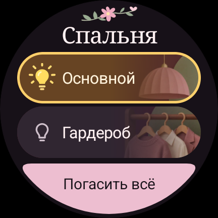

# Свет на запястье · Wiren Board для Wear OS

Пульт света для круглых часов Samsung Galaxy Watch 5 и 6. Смахните с циферблата до плитки «Дом», выберите комнату и коснитесь лампы. Первое открытие запускает демо. Часы и эмулятор работают в этом режиме без контроллера и учётной записи.

<p> </p>

## Попробовать за несколько минут

1. Скачайте файл `wirenboard-wear-os-0.6.2-demo.apk` из [выпуска 0.6.2](https://github.com/F4ntik/wirenboard-wear-os/releases/tag/v0.6.2). На компьютере с Android Platform Tools [подключите часы по Wi-Fi через ADB](https://developer.android.com/tools/adb#wireless-android11-command-line). В папке загрузок выполните `adb install -r wirenboard-wear-os-0.6.2-demo.apk`. Подойдут часы или круглый эмулятор Wear OS с Android API 30 и выше.
2. Откройте «Дом» → «Спальня», включите «Основной», затем нажмите «Погасить всё». В демо меняется только картинка на часах. Свайп вправо вернёт к списку комнат.
3. Чтобы добавить плитку на Galaxy Watch, смахните влево с циферблата до конца списка, нажмите «Добавить карточки» и выберите «Дом». Нажатие на комнату открывает её пульт. Свайп вправо из него возвращает к плитке.

Залитая лампочка с лучами означает включённый свет, контурная — выключенный. Значок часов появляется во время ожидания ответа контроллера, вопросительный знак — когда состояние неизвестно. В комнате «Погасить всё» действует сразу. На главном экране эта команда требует подтверждения для всего дома.

У каждой комнаты своя веточка над названием. Небольшой рисунок справа помогает узнать выключатель. Плафон и гардероб используют две картинки WebP общим размером 8,5 КиБ. Остальные предметы, веточки и значки нарисованы вектором и поставляются вместе с приложением. [Посмотреть все семь комнат](docs/rooms.webp).

## Подставить свой дом

Кухня и гостиная объединены в одну комнату с тремя выключателями. В коридоре два выхода. Санузел и душевая — отдельные комнаты в списке «Все комнаты». Кнопка «Погасить всё» внутри комнаты действует только на её выходы.

В комплекте учебная схема из двух шестиканальных реле с номерами `101` и `102`. Перед подключением откройте веб-интерфейс своего Wiren Board и выпишите каналы, которые действительно управляют освещением.

Для начала достаточно одной лампы. Так выглядит строка учебной схемы, которую можно дать ИИ-помощнику вместе со ссылкой на проект.

| Комната | Надпись на кнопке | Откуда читать состояние | Куда отправлять 1 или 0 |
| --- | --- | --- | --- |
| Кухня-гостиная | На кухне | `/devices/wb-mr6c_101/controls/K3` | `/devices/wb-mr6c_101/controls/K3/on` |

| Что изменить | Где смотреть |
| --- | --- |
| Названия комнат, ламп и номера выходов | `ALL` в [Rooms.java](app/src/main/java/com/galaxywatch/home/Rooms.java). Например, `new Light("Основной", "101", "K3")` читает `/devices/wb-mr6c_101/controls/K3` и пишет `1` или `0` в тот же путь с окончанием `/on`. Для другой модели устройства измените `stateTopic()`. |
| Общее выключение и режим «Отпуск» | `ALL_OFF` и `VACATION` в том же файле. Укажите существующие каналы своего контроллера. В `MASTER_LIGHTS` перечислите именно те выходы, которые отключает ваша команда. В примере `102/K4` входит только в общее выключение. |
| Какие комнаты показываются на плитке | [HomeTile.java](app/src/main/java/com/galaxywatch/home/HomeTile.java) берёт первые четыре комнаты из `ALL`. Если в вашей схеме их меньше четырёх, адаптируйте построение рядов и список ресурсов плитки. Значки выбираются в [RoomIcons.java](app/src/main/java/com/galaxywatch/home/RoomIcons.java). |
| Удалённый доступ | В [gateway.py](remote/gateway.py) задайте те же каналы в `LIGHTS`, `INDIVIDUAL_LIGHTS`, `VACATION` и `ALL_OFF`. Идентификатор выхода, например `101/K3`, должен совпадать на часах и шлюзе. [Настройка HTTPS и привязка часов](remote/README.md). |

После сборки откройте на часах **Подключение**, укажите частный IPv4-адрес своего брокера, при необходимости с портом, и нажмите **Готово** в автоматическом режиме. Локальный клиент рассчитан на доверенную сеть и брокер без пароля. Когда значение «Отпуска» неизвестно или режим включён, команды блокируются. Если после подключения кнопки остаются недоступными, проверьте этот канал и получение начальных состояний ламп. [Описание MQTT в Wiren Board](https://wiki.wirenboard.com/wiki/MQTT)

## Как часы выбирают соединение

В режиме **Автоматически** часы одновременно запрашивают состояние по домашнему адресу и через привязанный WB Cloud. Первый канал, по которому подтвердились «Отпуск» и хотя бы одна лампа, становится рабочим. Часы закрывают вторую попытку. Если один канал не ответил, второй продолжает подключаться. Без привязки к облаку часы используют только локальное соединение.

**Как часы узнают дом?** У сохранённого адреса может оказаться другой владелец, например в гостевом Wi-Fi. При облачной привязке часы читают локальный MQTT-канал `/devices/system/controls/Short SN` и сверяют серийный номер с номером выбранного Wiren Board. Также проверяют подписку и состояния освещения. Совпадения IP или названия Wi-Fi недостаточно. Без облачной привязки локальная проверка опирается на состояния дома.

Пока идёт выбор, на экране видно «Проверяем связь…». Затем под названием комнаты появляется **Домашняя сеть** или **WB Cloud**. Если победило облако, при открытом пульте часы примерно через 30 секунд снова проверят прямую связь. Переход домой откладывается до завершения текущей команды. Каждое нажатие отправляется по одному каналу. Если подтверждение потерялось, пульт покажет «Нет подтверждения».

В режиме **Вручную** выберите **Домашняя сеть**, **WB Cloud** или настроенный **Свой HTTPS**. Этот выбор сохраняется до следующего изменения. При обновлении с версии 0.5.1 обычное домашнее и облачное подключения получают автоматический выбор. Ранее настроенный собственный HTTPS остаётся в ручном режиме.

**Нужен ли часам собственный Wi-Fi?** Для WB Cloud достаточно интернета. Когда часы связаны с Android-телефоном по Bluetooth, Wear OS обычно передаёт их сетевые запросы через телефон, в том числе через его мобильный интернет. Часы также могут использовать свой Wi-Fi. «Домашняя сеть» на экране означает прямую связь с контроллером, а «WB Cloud» — связь через облако. Эти надписи показывают путь команды, независимо от того, как часы вышли в сеть. Одинаковый диапазон адресов дома и в гостях не мешает проверке привязанного контроллера. [Как Wear OS использует сеть](https://developer.android.com/training/wearables/data/network-communication)

Для связи через WB Cloud часам и контроллеру нужен интернет. Облако достаточно один раз привязать на компьютере. Ручной режим «Домашняя сеть» поддерживает и контроллеры без канала серийного номера.

Для управления вне дома установите шлюз как пакет Wiren Board, добавьте его порт в «Сервисы» WB Cloud и выполните привязку на компьютере. Готовый пульт открывается на часах без входа на сайт. Доступ по собственному HTTPS-адресу настраивается в «Подключение → Вручную → Свой HTTPS». [Настройка шлюза и часов](remote/README.md).

## Сборка и проверка

Для своей карты комнат соберите приложение с JDK 17 и Android SDK Platform 36. В Android Studio можно открыть репозиторий, выбрать модуль `app` и нажать **Run**. Для сборки и проверок в терминале Windows выполните команду.

```powershell
.\gradlew.bat :app:assembleDebug :app:testDebugUnitTest :app:lintDebug
```

На Linux или macOS используйте `./gradlew` с теми же аргументами. Готовый APK находится в `app/build/outputs/apk/debug/app-debug.apk`. Его можно установить на подключённые часы командой `adb install -r app/build/outputs/apk/debug/app-debug.apk`.

Если сначала установили готовое демо, при переходе на собственную сборку Android может сообщить `INSTALL_FAILED_UPDATE_INCOMPATIBLE`. Причина в разных подписях приложений. Удалите с часов учебное приложение (`adb uninstall com.galaxywatch.home.sample`) и установите свою сборку. Удаление стирает настройки этого приложения и его привязку.

Если меняли шлюз, установите зависимости и проверьте его на имитации MQTT-брокера.

```sh
python -m pip install -r remote/requirements.txt
python -B -m unittest discover -s remote -v
```

Для работы с помощником в репозитории есть [карта проекта и сценарий проверки](AGENTS.md). Пример первой задачи для агента — «По моей таблице комнат и MQTT-каналов обнови пример, согласуй карту на часах и шлюзе и проверь переключение в демо».

Авторский код и оформление доступны по [лицензии MIT](LICENSE). Для Gradle Wrapper приложены [лицензия](gradle/wrapper/LICENSE) и [уведомления](gradle/wrapper/NOTICE). Сторонние библиотеки сохраняют свои лицензии.

[История выпусков и проверок](CHANGELOG.md).
