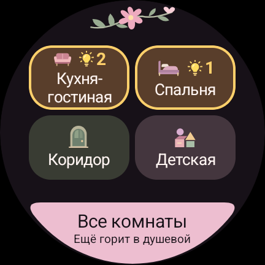

# Свет на запястье · Wiren Board для Wear OS

Пульт света для круглых часов Samsung Galaxy Watch 5 и 6. Смахните с циферблата до плитки «Дом», выберите комнату и коснитесь лампы. При первом открытии можно подключить собственный Wiren Board или посмотреть демо. Комнаты, лампы и оформление домашнего пульта задаются на контроллере.

<p> </p>

## С чего начать

Готовые файлы лежат в [выпуске 0.8.0](https://github.com/F4ntik/wirenboard-wear-os/releases/tag/v0.8.0). Для своего дома нужны приложение на часах и пакет на контроллере. Для демо достаточно приложения.

| Куда установить | Что скачать | Как запустить |
| --- | --- | --- |
| На часы с компьютера Windows | [Комплект Windows (.zip)](https://github.com/F4ntik/wirenboard-wear-os/releases/download/v0.8.0/wirenboard-wear-os-0.8.0-windows.zip) | Распакуйте архив и откройте `install_watch.cmd`. APK уже внутри. Нужны Python 3 и команда `adb` из [Android Platform Tools](https://developer.android.com/tools/releases/platform-tools). |
| На часы с любого компьютера через ADB | [Приложение (.apk)](https://github.com/F4ntik/wirenboard-wear-os/releases/download/v0.8.0/wirenboard-wear-os-0.8.0.apk) | В папке загрузок выполните `adb install -r wirenboard-wear-os-0.8.0.apk`. При обновлении настройки сохранятся. |
| На контроллер Wiren Board | [Пакет интеграции (.deb)](https://github.com/F4ntik/wirenboard-wear-os/releases/download/v0.8.0/wb-wear-light-gateway_0.2.0_all.deb) | Скопируйте файл на контроллер и установите пакет. [Пошаговая инструкция](remote/README.md#пакет-для-контроллера-wiren-board) |

Свою версию приложения можно собрать по [пошаговому руководству от исходников до запуска на часах](docs/build-and-debug.md).

**Первое подключение часов к компьютеру.** Подключите оба устройства к одной сети Wi-Fi и включите на часах беспроводную отладку в параметрах разработчика. Для `adb pair` возьмите адрес, порт и код из окна сопряжения. Для `adb connect` используйте адрес и порт с основного экрана беспроводной отладки. Нужны данные самих часов. [Как включить отладку на Galaxy Watch и выполнить сопряжение](docs/build-and-debug.md#3-отладка-на-часах)

**Попробовать демо.** В приложении выберите демо, откройте спальню и коснитесь «Основной». Изменится только картинка на часах. Чтобы добавить системную плитку, смахните влево с циферблата до конца списка, нажмите «Добавить карточки» и выберите «Дом».

**Подключить своё освещение.** Для начала достаточно одной комнаты и одного выключателя. Добавьте их в веб-интерфейсе WB, на часах выберите «Подключить дом» и введите адрес контроллера. Дома пульт работает без учётной записи WB Cloud. Для управления вне дома облако можно привязать позже с компьютера. [Настроить комнаты](#подключить-свой-дом) · [Подключить WB Cloud](remote/README.md#привязка-через-wiren-board-cloud)

## На чём проверено

| Устройство | Проверенная конфигурация |
| --- | --- |
| Контроллер | Wiren Board 8, аппаратная ревизия **8.5.2**, процессор **T507**. Debian GNU/Linux 13 (trixie), ветка ПО Wiren Board `testing` (`unstable.latest`). |
| Интеграция | `wb-wear-light-gateway` **0.2.0**, веб-интерфейс `wb-mqtt-homeui` **2.289.2**, редактор настроек `wb-mqtt-confed` **1.18.7**. |
| Часы | Samsung Galaxy Watch6 **SM-R930**, Android 16 (API 36), пульт **0.8.0** с преднастроенным домом. |

На этом комплекте часы показали те же состояния 11 ламп, что и контроллер. При переключении света через WB Cloud проверили и выключение, и возврат в исходное состояние. Для проверки автоматического выбора сделали локальное подключение недоступным, сохранив интернет. Часы выбрали WB Cloud, а при восстановлении доступа снова показали «Домашняя сеть».

Публичное приложение с первичной привязкой, настройки яркости и цвета проверены на эмуляторе Wear OS с тестовым контроллером. Galaxy Watch 5 на физическом устройстве пока не проверяли.

## Управление с часов

У включённой лампы золотая рамка вокруг всей кнопки и заполненный жёлтый значок. Пока комната открыта, лучи плавно расходятся и возвращаются. Если в настройках часов отключить анимации, значок и рамка останутся видны. Выключенная лампа обозначена тонким контуром на тёмной кнопке. Значок часов появляется во время ожидания ответа контроллера, вопросительный знак — когда состояние неизвестно. В комнате «Погасить здесь» действует сразу. В списке комнат кнопка «Погасить весь дом» сначала просит подтвердить выключение. [Посмотреть движение лучей](docs/lamp-motion.webp)

У каждой комнаты своя веточка над названием. Небольшой рисунок справа помогает узнать выключатель. Плафон и гардероб используют две картинки WebP общим размером 8,5 КиБ. Остальные предметы, веточки и значки нарисованы вектором и поставляются вместе с приложением. [Посмотреть все семь комнат](docs/rooms.webp).

## Свет по комнатам

На плитке — четыре избранные комнаты. Золотая рамка и цифра показывают, сколько ламп точно горит. «1+» означает, что одна включена, а по части ламп ещё нет данных. Тёмная карточка без цифры означает, что все лампы в комнате погашены. Знак «?» появляется, если выключение всех ламп пока не подтверждено. Нажатие на любую карточку открывает комнату.

Если горит одна из остальных комнат, под «Все комнаты» появится её название, например «Ещё горит в душевой». Если таких комнат две или три, появится «Ещё в 2 комнатах» или «Ещё в 3 комнатах». Если по остальным комнатам пришли только выключенные либо неизвестные значения, плитка покажет «Не всё известно», пока остаются неизвестные. Когда все остальные комнаты точно погашены, подпись исчезнет.

В списке комнат нажмите **Где горит**. Вверху останутся комнаты с включёнными лампами. Ниже, отдельно, будут комнаты без полных данных. Кнопка **Все комнаты** вернёт обычный список. Чтобы заменить избранную комнату, откройте **Настройки → Избранные комнаты**, выберите одно из четырёх мест и нужную комнату. Если комната уже на плитке, две комнаты поменяются местами. [Посмотреть фильтр на часах](docs/where-lit.png)

Плитка хранит последние подтверждённые значения каждой лампы. При запросе плитки часы могут перечитать состояние дома. Через две минуты без подтверждения показание устаревает и перестаёт учитываться. После щелчка настенным выключателем изменение может появиться с задержкой: время обновления системной плитки выбирает Wear OS. В открытом пульте состояния приходят по действующему соединению. [Обновление плиток Wear OS](https://developer.android.com/training/wearables/tiles/update)

## Подключить свой дом

1. Установите пакет `wb-wear-light-gateway_0.2.0_all.deb` на контроллер. В его веб-интерфейсе откройте **Интеграции → Пульт света Wear OS** и включите интеграцию. [Установка пакета](remote/README.md)
2. Добавьте комнату и введите её название. В разделе «Оформление комнаты» можно выбрать стиль комнаты. Добавьте лампу и в поле выключателя начните вводить название устройства или канала. Выберите свой выход из списка. Имя кнопки на часах можно задать самостоятельно.
3. Откройте «Оформление, яркость и цвет», если нужны дополнительные возможности. Для диммера выберите канал яркости с диапазоном 0–100. Для цветного светильника выберите канал RGB. У обычного реле достаточно выключателя. Для обычного дома оставьте раздел **Для всего дома** пустым и нажмите **Записать**. Кнопка на часах всё равно погасит все добавленные лампы.
4. Дома в приложении часов откройте **Подключить дом**, введите локальный IPv4-адрес контроллера (можно с портом MQTT), сверьте найденный контроллер и подтвердите. Часы сохранят его серийный номер. Следующие изменения комнат поступят автоматически. В демо вход в подключение есть в настройках.

Для первой проверки добавьте в одну комнату один известный светильник. Откройте комнату и щёлкните настенным выключателем. Когда состояние на часах изменится, проверьте переключение с запястья. Кнопки яркости и цвета появляются у ламп с соответствующими каналами. Локальный режим рассчитан на доверенную сеть с доступным MQTT-брокером. [Каналы и их типы в Wiren Board](https://wiki.wirenboard.com/wiki/MQTT)

Если у вас уже есть сценарий «Я ухожу», кнопке **Погасить весь дом** можно поручить его запуск. Отдельно можно выбрать переключатель, который временно блокирует команды с часов. Оба поля необязательны. [Как подключить свой сценарий или сделать его с нуля](docs/house-scenarios.md)

[Выбор цвета на часах](docs/catalog-color.png)

### Как обновляется интерфейс

Контроллер вычисляет версию по содержимому каталога. При первом подключении часы получают каталог целиком. При следующих проверках сначала сверяют версию. Новое название, канал, порядок или оформление поднимают новую версию. Смена яркости или включение света меняют только состояние. Новая версия заменяет сохранённую схему целиком после проверки данных. Изображения входят в приложение. Через сеть передаются названия, идентификаторы тем и привязки каналов.

Открытый пульт проверяет изменения сам. Системная плитка может обновиться без запуска приложения. Wear OS определяет время вызова плитки. Для дома без интернета достаточно подключения к контроллеру по локальной сети. Для работы вне дома один раз привяжите WB Cloud с компьютера. [Привязка WB Cloud](remote/README.md#привязка-через-wiren-board-cloud)

## Как часы выбирают соединение

В режиме **Автоматически** часы одновременно запрашивают состояние по домашнему адресу и через привязанный WB Cloud. Для настроенного дома с лампами рабочим становится первый канал, по которому пришло состояние хотя бы одной лампы. Если выбран переключатель блокировки, часы также ждут его состояние. Часы закрывают вторую попытку. Если один канал не ответил, второй продолжает подключаться. Без привязки к облаку часы используют только локальное соединение.

**Как часы узнают дом?** У сохранённого адреса может оказаться другой владелец, например в гостевом Wi-Fi. При облачной привязке часы читают локальный MQTT-канал `/devices/system/controls/Short SN` и сверяют серийный номер с номером выбранного Wiren Board. Также проверяют подписку и состояния освещения. Совпадения IP или названия Wi-Fi недостаточно. В настраиваемом пульте номер запоминается и при первичной локальной привязке. Прежний пульт с фиксированной картой без облачной привязки проверяет состояния дома.

В открытом пульте видно, откуда пришли данные: **Домашняя сеть** или **WB Cloud**. Каждое нажатие отправляется по одному каналу. Если ответ не пришёл, приложение покажет ошибку подтверждения и заново проверит состояние.

В режиме **Вручную** выберите **Домашняя сеть**, **WB Cloud** или настроенный **Свой HTTPS**. Этот выбор сохраняется до следующего изменения. При обновлении с версии 0.5.1 обычное домашнее и облачное подключения получают автоматический выбор. Ранее настроенный собственный HTTPS остаётся в ручном режиме.

**Нужен ли часам собственный Wi-Fi?** Для WB Cloud достаточно интернета. Когда часы связаны с Android-телефоном по Bluetooth, Wear OS обычно передаёт их сетевые запросы через телефон, в том числе через его мобильный интернет. Часы также могут использовать свой Wi-Fi. «Домашняя сеть» на экране означает прямую связь с контроллером, а «WB Cloud» — связь через облако. Эти надписи показывают путь команды, независимо от того, как часы вышли в сеть. Одинаковый диапазон адресов дома и в гостях не мешает проверке привязанного контроллера. [Как Wear OS использует сеть](https://developer.android.com/training/wearables/data/network-communication)

Для связи через WB Cloud часам и контроллеру нужен интернет. Облако достаточно один раз привязать на компьютере. Для нового настраиваемого пульта контроллер должен сообщать серийный номер.

Для управления вне дома установите шлюз как пакет Wiren Board, добавьте его порт в «Сервисы» WB Cloud и выполните привязку на компьютере. Готовый пульт открывается на часах без входа на сайт. Доступ по собственному HTTPS-адресу настраивается в «Настройки → Подключение → Вручную → Свой HTTPS». [Настройка шлюза и часов](remote/README.md).

## Сборка и проверка

В руководстве есть установка Android Studio и SDK, сборка APK из чистой копии, включение режима разработчика на Galaxy Watch, подключение через Wi-Fi, установка и запуск отладчика. Там же разобраны разные порты сопряжения и подключения, выбор нужных часов и конфликт подписи. [Собрать и отладить пульт пошагово](docs/build-and-debug.md)

В уже настроенном окружении Windows сборку и проверки можно выполнить одной командой.

```powershell
.\gradlew.bat :app:assembleDebug :app:testDebugUnitTest :app:lintDebug
```

На Linux и macOS используйте `./gradlew` с теми же аргументами. Пакет для контроллера собирается отдельно. [Сборка пакета на Debian](remote/README.md#сборка-пакета-из-исходников)

Если меняли шлюз, установите зависимости и проверьте его на имитации MQTT-брокера.

```sh
python -m pip install -r remote/requirements.txt
python -B -m unittest discover -s remote -v
```

Для работы с помощником в репозитории есть [карта проекта и сценарий проверки](AGENTS.md). Пример задачи для агента — «По моей таблице комнат и каналов подготовь конфигурацию интеграции и проверь её на стенде».

Авторский код и оформление доступны по [лицензии MIT](LICENSE). Для Gradle Wrapper приложены [лицензия](gradle/wrapper/LICENSE) и [уведомления](gradle/wrapper/NOTICE). Сторонние библиотеки сохраняют свои лицензии.

[История выпусков и проверок](CHANGELOG.md).
